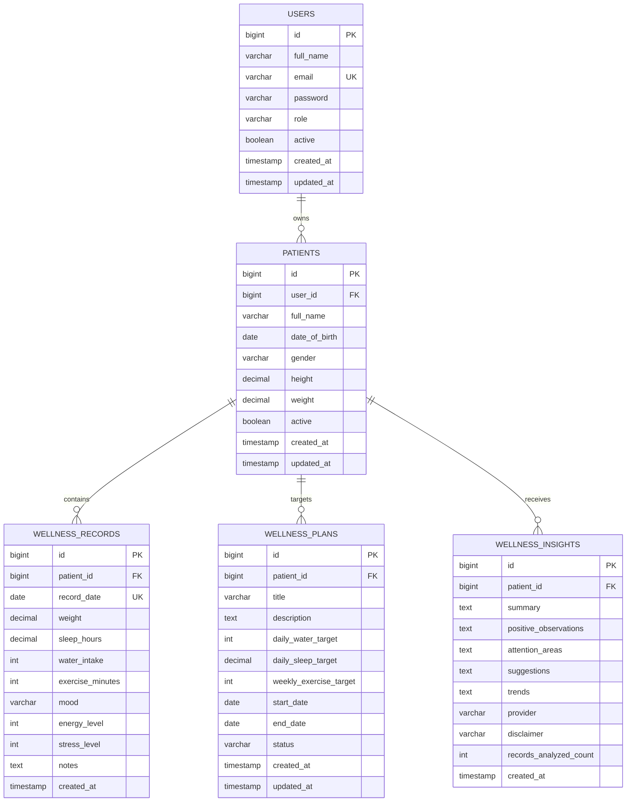

# AI-Enabled Patient Wellness Monitoring System

[](https://adoptium.net)
[](https://spring.io/projects/spring-boot)
[]()
[]()
[](LICENSE)

An enterprise-grade, production-style Spring Boot 3 backend application engineered on Java 21 for comprehensive patient wellness monitoring, statistical habit tracking, adherence goal management, and privacy-first AI-driven lifestyle insights with built-in medical safety guardrails.

---

## Table of Contents
1. [Project Overview & Problem Statement](#project-overview--problem-statement)
2. [Key Architecture & Design Principles](#key-architecture--design-principles)
3. [System Architecture Diagram](#system-architecture-diagram)
4. [Database Schema & ER Diagram](#database-schema--er-diagram)
5. [Core Features](#core-features)
6. [AI Wellness Insights & Safety Guardrails](#ai-wellness-insights--safety-guardrails)
7. [Security & Tenant Isolation](#security--tenant-isolation)
8. [Technology Stack](#technology-stack)
9. [REST API Reference](#rest-api-reference)
10. [Local Development Setup](#local-development-setup)
11. [Running with Docker Compose](#running-with-docker-compose)
12. [Executing Automated Tests](#executing-automated-tests)
13. [Postman Collection Usage](#postman-collection-usage)
14. [Swagger OpenAPI Documentation](#swagger-openapi-documentation)
15. [Environment Variables Reference](#environment-variables-reference)
16. [Verification & Test Results](#verification--test-results)
17. [License](#license)

---

## Project Overview & Problem Statement

Modern preventive health requires consistent tracking of daily lifestyle markers—such as sleep duration, hydration levels, physical activity, emotional state, and perceived stress. However, patients and wellness coaches often struggle with fragmented data, lack of actionable trend summaries, and unclear lifestyle guidance.

The **AI-Enabled Patient Wellness Monitoring System** addresses this challenge by providing:
- A secure multi-patient profile management portal for individuals and healthcare facilitators.
- Comprehensive logging of physiological and qualitative markers with validation boundaries.
- Automated statistical summaries over custom, weekly, and monthly time horizons.
- Goal tracking and adherence scoring against personalized lifestyle targets.
- An intelligent LLM subsystem providing constructive, evidence-based habit recommendations while maintaining strict zero-PII privacy and explicit non-medical disclaimers.

---

## Key Architecture & Design Principles

The application strictly adheres to Clean Layered Architecture:

```
[ Controllers ] -> [ Services & Domain Rules ] -> [ JPA Repositories ] -> [ MySQL 8.x / Flyway ]
```

- **DTO / Entity Separation**: Database entities are strictly encapsulated within the domain layer and never exposed across HTTP boundaries.
- **Defensive Input Validation**: Jakarta Bean Validation enforces physiological and temporal constraints before execution reaches domain services.
- **Stateless Security**: Zero HTTP session state; authentication operates via HMAC-SHA256 signed JWT bearer tokens.
- **Tenant Isolation**: Non-admin users are strictly bounded to their own patient entities and records.
- **Resilient AI Subsystem**: Pluggable provider design allowing OpenAI-compatible HTTP inference with automated fallback to a deterministic offline heuristic engine when no API key is present.

---

## System Architecture Diagram


---

## Database Schema & ER Diagram



---

## Core Features

### 1. User & Patient Identity Management
- BCrypt password encryption (strength cost 12).
- Stateless JWT issuance with configurable expiration.
- Soft-deactivation for patient profiles to preserve chronological clinical log integrity.

### 2. Wellness Record Tracking
- Daily logging of sleep (hours), hydration (mL), exercise duration (minutes), mood category, energy level (1-10), stress level (1-10), and subjective notes.
- Enforced date uniqueness: one daily log per patient per date.

### 3. Wellness Statistics & Summaries
- Real-time aggregation of metrics across custom intervals, trailing 7 days (weekly), and trailing 30 days (monthly).
- Computes completion percentage, arithmetic averages, weight change deltas, and mood distributions.

### 4. Wellness Plans & Target Adherence
- Target setting for hydration, sleep, and weekly exercise.
- Adherence calculation engines computing proportional progress against established targets.

### 5. AI Wellness Insights
- Automated synthesis of logged wellness history into readable lifestyle observations.
- Medical safety boundary enforcement and deterministic fallback engine.

---

## AI Wellness Insights & Safety Guardrails

The application integrates an AI analysis engine with strict ethical and clinical safeguards:

1. **Zero PII Exposure**: The `PromptBuilder` strips patient names, emails, and database keys. Prompts include only anonymized chronological health markers and derived age.
2. **Explicit Medical Guardrails**:
   - Strictly prohibits disease diagnosis, medication prescriptions, or clinical medical advice.
   - Mandates the disclaimer:  
     > *"AI Wellness Insights are generated for motivational and lifestyle educational purposes only. They do not constitute medical diagnosis, clinical treatment, prescription, or healthcare professional advice."*
3. **Deterministic Fallback Provider**: If no OpenAI API key is configured or the remote service is unavailable, the system transparently utilizes `DeterministicFallbackLLMProvider`, calculating evidence-based lifestyle suggestions and flagging output with `DETERMINISTIC_FALLBACK (Demo/Offline Mode)`.

---

## Security & Tenant Isolation

- **Stateless Authorization**: Validates incoming bearer tokens against `JwtTokenProvider` before dispatching to controllers.
- **Tenant Isolation**: `OwnershipValidator` enforces that standard users (`ROLE_USER`) can only query and mutate resources belonging to patients registered under their user ID. Attempted cross-tenant access returns `403 Forbidden`.
- **Credential Hygiene**: Password hashes and secret tokens are excluded from all response payloads and audit log outputs.

---

## Technology Stack

| Layer | Component | Version / Description |
| :--- | :--- | :--- |
| **Language** | Java | OpenJDK 21 LTS |
| **Framework** | Spring Boot | 3.3.5 |
| **Data Access** | Spring Data JPA / Hibernate | 6.x |
| **Security** | Spring Security & JJWT | 0.12.6 (HMAC-SHA256) |
| **Database** | MySQL | 8.x (InnoDB, UTF8mb4) |
| **Migrations** | Flyway | 10.x Versioned DDL |
| **Documentation** | Springdoc OpenAPI / Swagger UI | 2.6.0 |
| **Testing** | JUnit 5, Mockito, MockMvc, AssertJ | 28 automated tests (100% pass) |
| **Packaging** | Docker & Docker Compose | Multi-stage non-root container |

---

## REST API Reference

Base URI: `/api/v1`

### Authentication (`/api/v1/auth`)
| Method | Path | Description | Access |
| :--- | :--- | :--- | :--- |
| `POST` | `/api/v1/auth/register` | Register new user account | Public |
| `POST` | `/api/v1/auth/login` | Authenticate credentials & get JWT | Public |
| `GET` | `/api/v1/auth/me` | Retrieve authenticated user profile | Authenticated |

### Patients (`/api/v1/patients`)
| Method | Path | Description | Access |
| :--- | :--- | :--- | :--- |
| `POST` | `/api/v1/patients` | Create patient profile | Authenticated |
| `GET` | `/api/v1/patients` | List active patients for current user | Authenticated |
| `GET` | `/api/v1/patients/page` | List paginated patients for current user | Authenticated |
| `GET` | `/api/v1/patients/{patientId}` | Retrieve specific patient by ID | Owner / Admin |
| `PUT` | `/api/v1/patients/{patientId}` | Update patient profile | Owner / Admin |
| `DELETE` | `/api/v1/patients/{patientId}` | Deactivate patient profile | Owner / Admin |

### Wellness Records (`/api/v1/patients/{patientId}/wellness-records`)
| Method | Path | Description | Access |
| :--- | :--- | :--- | :--- |
| `POST` | `/api/v1/patients/{patientId}/wellness-records` | Log a daily wellness entry | Owner / Admin |
| `GET` | `/api/v1/patients/{patientId}/wellness-records` | Get records (paginated or date-filtered) | Owner / Admin |
| `GET` | `/api/v1/patients/{patientId}/wellness-records/recent` | Get trailing N daily records | Owner / Admin |
| `GET` | `/api/v1/patients/{patientId}/wellness-records/{recordId}` | Get single record by ID | Owner / Admin |
| `PUT` | `/api/v1/patients/{patientId}/wellness-records/{recordId}` | Update wellness record | Owner / Admin |
| `DELETE` | `/api/v1/patients/{patientId}/wellness-records/{recordId}` | Delete wellness record | Owner / Admin |

### Wellness Summaries (`/api/v1/patients/{patientId}/wellness-summary`)
| Method | Path | Description | Access |
| :--- | :--- | :--- | :--- |
| `GET` | `/api/v1/patients/{patientId}/wellness-summary` | Custom date-range summary | Owner / Admin |
| `GET` | `/api/v1/patients/{patientId}/wellness-summary/weekly` | Trailing 7-day summary | Owner / Admin |
| `GET` | `/api/v1/patients/{patientId}/wellness-summary/monthly` | Trailing 30-day summary | Owner / Admin |

### Wellness Plans
| Method | Path | Description | Access |
| :--- | :--- | :--- | :--- |
| `POST` | `/api/v1/patients/{patientId}/wellness-plans` | Create a wellness plan | Owner / Admin |
| `GET` | `/api/v1/patients/{patientId}/wellness-plans` | List plans for a patient | Owner / Admin |
| `GET` | `/api/v1/wellness-plans/{planId}` | Get plan details | Owner / Admin |
| `PUT` | `/api/v1/wellness-plans/{planId}` | Update plan details | Owner / Admin |
| `PATCH` | `/api/v1/wellness-plans/{planId}/status` | Update plan status (ACTIVE, COMPLETED, etc.) | Owner / Admin |
| `GET` | `/api/v1/wellness-plans/{planId}/progress` | Calculate adherence progress | Owner / Admin |

### AI Insights
| Method | Path | Description | Access |
| :--- | :--- | :--- | :--- |
| `POST` | `/api/v1/patients/{patientId}/insights/generate` | Generate AI wellness insights | Owner / Admin |
| `GET` | `/api/v1/patients/{patientId}/insights` | List previous insight reports for patient | Owner / Admin |
| `GET` | `/api/v1/insights/{insightId}` | Retrieve specific insight report | Owner / Admin |

### System Health
| Method | Path | Description | Access |
| :--- | :--- | :--- | :--- |
| `GET` | `/actuator/health` | Service health status | Public |

---

## Local Development Setup

### Prerequisites
- **Java 21** LTS installed
- **Maven 3.9+** installed
- **MySQL 8.x** running locally on port 3306

### Steps

1. **Clone the repository:**
   ```bash
   git clone https://github.com/Bharathsirikonda/ai-patient-wellness-monitoring-system.git
   cd ai-patient-wellness-monitoring-system
   ```

2. **Create MySQL database:**
   ```sql
   CREATE DATABASE patient_wellness_db CHARACTER SET utf8mb4 COLLATE utf8mb4_unicode_ci;
   CREATE USER 'wellness_user'@'localhost' IDENTIFIED BY 'wellness_pass';
   GRANT ALL PRIVILEGES ON patient_wellness_db.* TO 'wellness_user'@'localhost';
   FLUSH PRIVILEGES;
   ```

3. **Configure Environment:**
   Copy `.env.example` to `.env` and verify database credentials and JWT secret.

4. **Build and Run:**
   ```bash
   mvn clean spring-boot:run
   ```

---

## Running with Docker Compose

To start both MySQL and the backend service inside Docker:

```bash
docker compose up -d --build
```

The application will start on port `8080`, with MySQL on port `3306`. Persistent data is stored in the Docker volume `mysql_data`.

To stop services:
```bash
docker compose down
```

---

## Executing Automated Tests

The automated test suite runs against an isolated in-memory test database with Flyway migrations:

```bash
# Execute unit and integration tests
mvn clean test

# Execute full verification and packaging
mvn clean verify
```

---

## Swagger OpenAPI Documentation

Once the application is running:
- **Swagger UI Interactive Console**: [http://localhost:8080/swagger-ui.html](http://localhost:8080/swagger-ui.html)
- **OpenAPI JSON Specification**: [http://localhost:8080/v3/api-docs](http://localhost:8080/v3/api-docs)

To test secured endpoints in Swagger UI:
1. Call `POST /api/v1/auth/login`.
2. Copy the `accessToken`.
3. Click the **Authorize** button at the top of Swagger UI and enter `Bearer <accessToken>`.

---

## Postman Collection Usage

A complete, pre-configured Postman Collection is included in [`postman_collection.json`](postman_collection.json).

### Execution Flow:
1. Import `postman_collection.json` into Postman.
2. Run **1.1 User Registration** to register a test user.
3. Run **1.2 User Login** (automatically sets `{{jwtToken}}` collection variable).
4. Run **2.1 Create Patient Profile** (automatically sets `{{patientId}}`).
5. Run **3.1 Log Daily Wellness Record** (automatically sets `{{recordId}}`).
6. Run **4.1 Weekly Wellness Summary** or **4.2 Monthly Wellness Summary**.
7. Run **5.1 Create Wellness Plan** and **5.2 Track Plan Adherence Progress**.
8. Run **6.1 Generate AI Wellness Insight**.

---

## Environment Variables Reference

| Variable | Default Value | Description |
| :--- | :--- | :--- |
| `PORT` | `8080` | HTTP server port |
| `DB_HOST` | `localhost` | MySQL hostname |
| `DB_PORT` | `3306` | MySQL port |
| `DB_NAME` | `patient_wellness_db` | MySQL database name |
| `DB_USERNAME` | `wellness_user` | MySQL database username |
| `DB_PASSWORD` | `wellness_pass` | MySQL database password |
| `JWT_SECRET` | *(256-bit default string)* | 32+ character HMAC-SHA secret key |
| `JWT_EXPIRATION_MS`| `86400000` | Token validity duration in milliseconds (24h) |
| `LLM_PROVIDER` | `FALLBACK` | `OPENAI` for live remote inference, or `FALLBACK` |
| `LLM_API_KEY` | *(empty)* | OpenAI API key (when using OPENAI provider) |
| `LLM_API_URL` | `https://api.openai.com/v1` | Base URL for LLM completions |
| `LLM_MODEL` | `gpt-4o-mini` | LLM model identifier |

---

## Verification & Test Results

```
[INFO] Results:
[INFO] Tests run: 28, Failures: 0, Errors: 0, Skipped: 0
[INFO] ------------------------------------------------------------------------
[INFO] BUILD SUCCESS
[INFO] ------------------------------------------------------------------------
```

- **Unit Tests**: 22 passed (AuthService, PatientService, RecordService, PlanService, InsightService, StatisticsCalculator, JwtTokenProvider, OwnershipValidator, DeterministicFallbackLLMProvider).
- **Integration Tests**: 6 passed (AuthIntegrationTest, PatientWellnessE2EIntegrationTest covering complete end-to-end user workflows and cross-tenant isolation).
- **Medical Safety**: Verified presence of non-medical disclaimer and anonymized demographic payload formatting.
- **Tenant Boundary**: Verified 403 Forbidden enforcement when unprivileged users attempt cross-tenant access.

---

## License

This project is licensed under the terms of the [MIT License](LICENSE).
