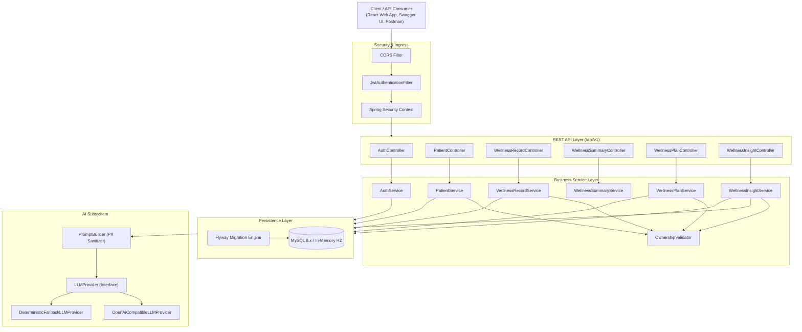
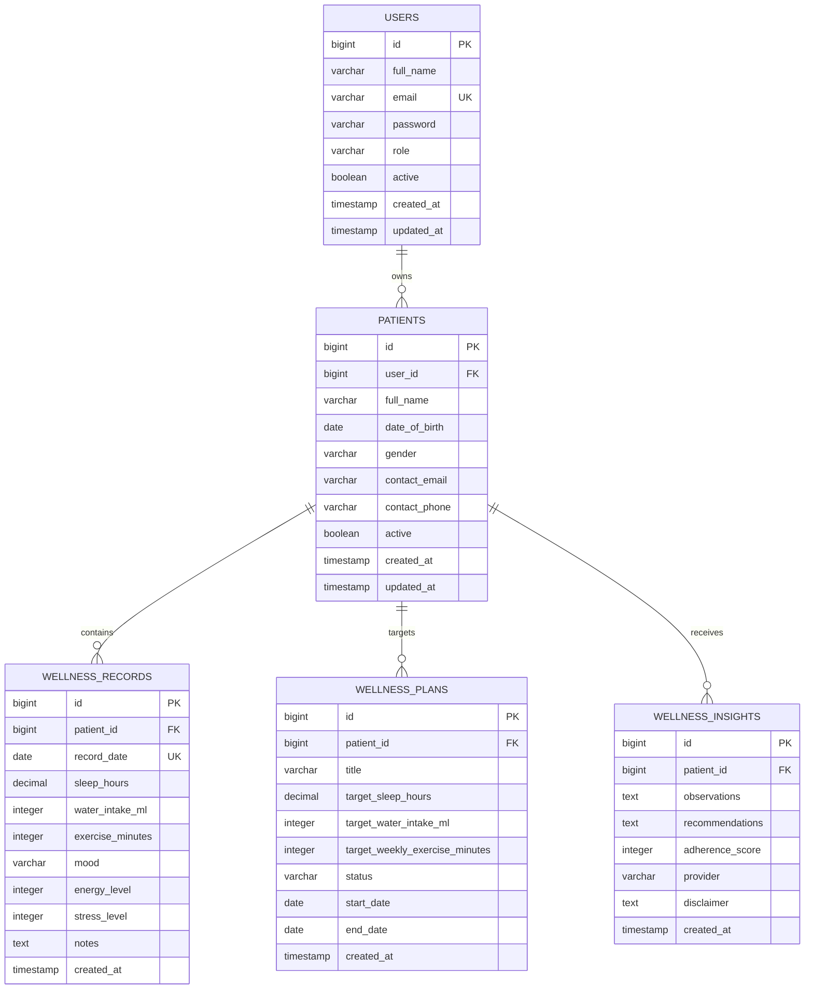

# 🩺 AI-Enabled Patient Wellness Monitoring Platform

[](https://adoptium.net)
[](https://spring.io/projects/spring-boot)
[](https://react.dev)
[](https://vitejs.dev)
[](https://tailwindcss.com)
[]()
[](https://frontend-green-six-22.vercel.app)
[](https://render.com)
[](LICENSE)

An enterprise-grade, full-stack healthcare web application engineered with **Spring Boot 3**, **Java 21**, **React**, and **Tailwind CSS** for comprehensive patient wellness monitoring, statistical habit tracking, adherence goal management, and privacy-first AI-driven lifestyle insights with built-in medical safety guardrails.

---

# 🚀 Live Demo

### 🌐 Frontend (React + Vite + Tailwind on Vercel)
👉 **[https://frontend-green-six-22.vercel.app](https://frontend-green-six-22.vercel.app)**

### 📖 Swagger OpenAPI Interactive Documentation
👉 **[https://ai-patient-wellness-backend.onrender.com/swagger-ui/index.html](https://ai-patient-wellness-backend.onrender.com/swagger-ui/index.html)**  
*(Local: `http://localhost:8080/swagger-ui/index.html`)*

---

# ✨ Features

## 🔐 Authentication & Multi-Tenant Security
- **Stateless JWT Security**: HMAC-SHA256 bearer tokens with 24-hour expiration.
- **BCrypt Encryption**: Passwords salted and hashed with strength cost 12.
- **Tenant Isolation**: Strict ownership validation (`OwnershipValidator`) ensures users can only access patient records registered under their authenticated account (`403 Forbidden` enforced on cross-tenant attempts).

## 👤 Patient Identity & Profile Registry
- Secure multi-patient registry supporting healthcare practitioners and individual patients.
- Tracks legal demographic markers (DOB, Gender, Contact Email, Phone).
- Soft-deactivation to preserve chronological medical audit integrity.

## 📊 Daily Wellness Vitals Tracking
- High-fidelity daily logging of physiological and behavioral markers:
  - Sleep duration (hours/night)
  - Hydration volume (mL/day with quick-fill presets)
  - Physical activity duration (minutes/day)
  - Emotional state / Mood categorization (EXCELLENT, HAPPY, NEUTRAL, TIRED, STRESSED)
  - Perceived vitality / Energy score (1 - 10)
  - Perceived stress tension score (1 - 10)
  - Subjective clinical & lifestyle notes
- **Strict Data Integrity**: Jakarta Bean Validation enforces physiological bounds and single-entry-per-day constraints.

## 📈 Real-Time Statistical Summaries
- Real-time aggregation over custom date ranges, trailing 7 days (weekly), and trailing 30 days (monthly).
- Computes completion percentages, arithmetic averages, weight deltas, and mood distributions.

## 🎯 Target Goal Plans & Adherence Engine
- Customizable wellness benchmarks for daily sleep, hydration volume, and weekly cardio targets.
- Real-time adherence computation calculating percentage compliance against targets.

## 🤖 Privacy-First AI Insights Subsystem
- Synthesizes logged wellness history into readable lifestyle observations.
- **Zero PII Exposure**: Sanitizer strips patient names, emails, and database keys before prompt generation.
- **Strict Medical Safety Guardrail**: Prohibits diagnosis, prescriptions, or clinical medical advice, mandating regulatory disclaimers.
- **Deterministic Fallback Provider**: Includes an offline heuristic engine ensuring 100% uptime even when no OpenAI API key is configured.

---

# 🏗 System Architecture Diagram



---

# 🗄 Database Schema & ER Diagram



---

# 🛠 Technology Stack

### Backend
- **Language**: Java 21 LTS (OpenJDK Temurin)
- **Framework**: Spring Boot 3.3.5
- **Security**: Spring Security & JJWT 0.12.6
- **Persistence**: Spring Data JPA, Hibernate 6.x, Flyway Migrations
- **Database**: MySQL 8.x / In-Memory H2 for local zero-dependency testing
- **API Documentation**: Springdoc OpenAPI / Swagger UI 2.6.0
- **Testing**: JUnit 5, Mockito, MockMvc, AssertJ (28 automated tests passing)

### Frontend
- **Framework**: React 18
- **Build Tool**: Vite 5.4
- **Styling**: Tailwind CSS 3.4
- **Icons**: Lucide React
- **HTTP Client**: Axios (with auto JWT interceptor)

### Cloud & Deployment
- **Frontend**: Deployed on **Vercel** ([frontend-green-six-22.vercel.app](https://frontend-green-six-22.vercel.app))
- **Backend**: Containerized with **Docker** & deployed on **Render**
- **Blueprint**: Automated 1-click Render blueprint (`render.yaml`)

---

# 📂 Project Structure

```text
ai-patient-wellness-monitoring-system
│
├── backend
│   ├── src
│   │   ├── main/java/com/patientwellness
│   │   │   ├── config           # Security, Swagger, JPA configuration
│   │   │   ├── controller       # REST API endpoints (/api/v1)
│   │   │   ├── dto              # Request and Response transfer objects
│   │   │   ├── entity           # JPA Domain entities
│   │   │   ├── exception        # RFC 7807 global exception handlers
│   │   │   ├── integration/llm  # AI PromptBuilder & Fallback LLM engine
│   │   │   ├── repository       # Spring Data JPA repositories
│   │   │   ├── security         # JWT token provider & filter
│   │   │   ├── service          # Business logic & tenant validation
│   │   │   └── util             # Statistics and date calculators
│   │   └── main/resources       # Database migrations & YAML configs
│   ├── pom.xml                  # Backend Maven build file
│   ├── Dockerfile               # Multi-stage container definition
│   ├── mvnw & mvnw.cmd          # Maven wrapper scripts
│   ├── .env.example             # Backend environment template
│   └── postman_collection.json  # Pre-configured Postman test suite
│
├── frontend
│   ├── src
│   │   ├── components           # Navbar, Dashboard, PatientManager, Logger, etc.
│   │   ├── services/api.js      # Axios client with fallback resilience
│   │   ├── data/mockData.js     # Standalone demo data
│   │   ├── App.jsx              # Main React layout
│   │   ├── index.css            # Tailwind custom styles
│   │   └── main.jsx             # React entry point
│   ├── package.json             # Frontend dependencies
│   ├── vite.config.js           # Vite dev server and proxy
│   └── index.html               # Web HTML entry
│
├── render.yaml                  # Render Cloud 1-Click Blueprint
├── docker-compose.yml           # Local multi-container Docker compose
├── pom.xml                      # Root Maven multi-module orchestrator
└── README.md                    # Project documentation
```

---

# 📡 REST API Modules

Base URI: `/api/v1`

| Module | Method | Path | Description | Access |
| :--- | :--- | :--- | :--- | :--- |
| **Auth** | `POST` | `/api/v1/auth/register` | Register new user account | Public |
| **Auth** | `POST` | `/api/v1/auth/login` | Authenticate & retrieve JWT | Public |
| **Patients** | `POST` | `/api/v1/patients` | Create patient profile | Authenticated |
| **Patients** | `GET` | `/api/v1/patients` | List patients for active user | Authenticated |
| **Patients** | `GET` | `/api/v1/patients/{id}` | Get patient details by ID | Owner / Admin |
| **Records** | `POST` | `/api/v1/patients/{id}/wellness-records` | Log daily vitals entry | Owner / Admin |
| **Records** | `GET` | `/api/v1/patients/{id}/wellness-records/recent`| Get trailing N daily records | Owner / Admin |
| **Summary** | `GET` | `/api/v1/patients/{id}/wellness-summary/weekly`| Trailing 7-day rollup | Owner / Admin |
| **Summary** | `GET` | `/api/v1/patients/{id}/wellness-summary/monthly`| Trailing 30-day rollup | Owner / Admin |
| **Plans** | `POST` | `/api/v1/patients/{id}/wellness-plans` | Create a target wellness plan | Owner / Admin |
| **Plans** | `GET` | `/api/v1/wellness-plans/{id}/progress` | Calculate adherence progress | Owner / Admin |
| **AI Insights** | `POST` | `/api/v1/patients/{id}/insights/generate` | Synthesize lifestyle AI insights | Owner / Admin |
| **Health** | `GET` | `/actuator/health` | Spring Boot Actuator status | Public |

---

# ⚙️ Local Development Setup

## 1. Clone Repository
```bash
git clone https://github.com/Bharathsirikonda/ai-patient-wellness-monitoring-system.git
cd ai-patient-wellness-monitoring-system
```

## 2. Backend Setup
```bash
cd backend

# Option A: Run with in-memory H2 database (zero setup needed)
mvn spring-boot:run "-Dspring-boot.run.profiles=local"

# Option B: Run with local MySQL
mvn spring-boot:run
```
Backend starts on **`http://localhost:8080`**.  
Interactive Swagger docs: **`http://localhost:8080/swagger-ui/index.html`**

## 3. Frontend Setup
```bash
cd ../frontend

npm install
npm run dev
```
Frontend starts on **`http://localhost:5173`**.

---

# ☁️ Deploying to Render (Backend)

The repository includes a ready-to-use Render Blueprint (`render.yaml`):

1. Log in to [Render](https://render.com) using **GitHub**.
2. Click **New +** ➔ **Blueprint** (or **Web Service**).
3. Connect your repository: `ai-patient-wellness-monitoring-system`.
4. Render automatically applies `render.yaml` and deploys the Docker container to `https://ai-patient-wellness-backend.onrender.com`.

---

# 🧪 Automated Testing

Execute the complete 28-test verification suite:
```bash
cd backend
mvn clean test
```

```text
[INFO] Results:
[INFO] Tests run: 28, Failures: 0, Errors: 0, Skipped: 0
[INFO] BUILD SUCCESS
```

---

# 👨‍💻 Author

**Bharath Sirikonda**  
Software Engineer — Java Backend Developer  
- **GitHub**: [github.com/Bharathsirikonda](https://github.com/Bharathsirikonda)  
- **LinkedIn**: [linkedin.com/in/bharath-sirikonda-73775a25b](https://www.linkedin.com/in/bharath-sirikonda-73775a25b)  
- **Email**: [bharathsirikonda2003s@gmail.com](mailto:bharathsirikonda2003s@gmail.com)  

---

## ⭐ Support
If you found this project helpful, feel free to star the repository!
